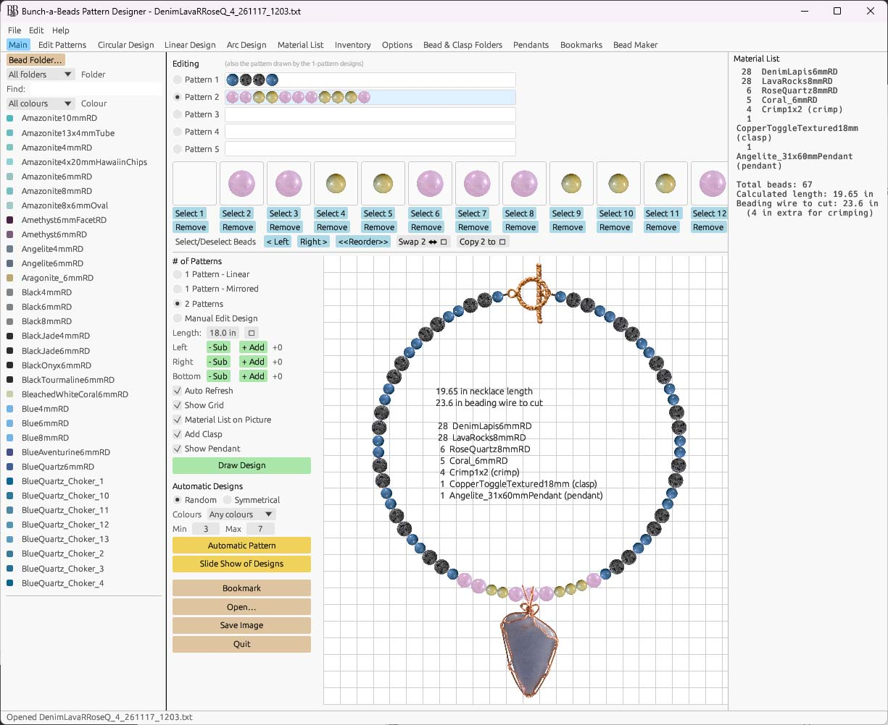

# Bunch-a-Beads Pattern Designer

Design bead necklaces and bracelets on screen before you string them. Choose beads from your own photo library, build patterns (or let it make automatic designs in matching colours), and see the finished piece as a circle, a straight strand, or hanging between two hands. It works out the length, a material list, the cost, and what you still need to buy, and prints a one-page design sheet.

It's a cross-platform Rust rewrite of the 2013 Visual Basic program *Bunch-a-Beads Pattern Design Pro*, and runs on Windows, Linux and macOS.



## Download
Ready-to-run downloads for Windows, Linux and macOS are on the [**Releases**](../../releases) page. Each one holds the program and a `BAB_library` folder of sample beads, clasps, crimps, pendants and designs.

1. Unzip it anywhere and run `BunchABeads` (Windows: `BunchABeads.exe`). Windows may say "Windows protected your PC" because the program isn't signed: click **More info > Run anyway**. On a Mac, right-click it and choose **Open** the first time.
2. On the **Bead & Clasp Folders** tab, choose `BAB_library` as the **Main Folder**.
3. Back on the **Main** tab, try **Slide Show of Designs**, or pick beads and build your own pattern.

**Try it without installing:** the web version runs in a browser at [zewind.com/bab.htm](https://www.zewind.com/bab.htm).

**Manual:** [Bunch-a-Beads User Manual (PDF)](docs/Bunch-a-Beads-Manual.pdf) explains every tab.

## Features
- Design from photos of your own beads, or beads drawn by the built-in **Bead Maker** (round, faceted, rondelle, tube, chip and more, in glass, stone, pearl, metal or wood, or wrapped with a stone photo).
- Up to 5 patterns of 12 beads, repeated to the length you want: linear, mirrored, two-pattern, or a fully manual design. Drag beads to rearrange them; undo anything.
- Automatic designs, random or symmetrical, in matching, contrasting or other colour schemes, plus a slide show.
- Clasps, 0 to 2 crimp beads per end, and pendants with an adjustable hang point.
- See the design as a circle, a straight strand (with zoom), or hanging between two hands.
- Material list with length and wire to cut, an inventory with prices and a shopping list, and a one-page PDF design sheet.
- Opens bookmarks and settings from the 2013 program.
- Runs on Windows, Linux and macOS, and in a web browser.

## Building it yourself

```
BunchABeadsRs/
├─ Cargo.toml          workspace: lists the two crates below
├─ beads-core/         all the bead logic, with no GUI and no dependencies
│  └─ src/  arc.rs       Arc Design: 2013 arc view and the hanging (catenary) view
│           colour.rs    bead colours from the photos, and colour schemes for automatic designs
│           inventory.rs stock, prices, costs and shopping lists
│           catalog.rs   bead pictures, sizes (300 dpi), BeadGuide .txt adjustments, folder scanning
│           pdf.rs       the one-page PDF design sheet (written directly, no libraries)
│           pattern.rs   12-slot patterns, shift/reorder, random and symmetrical automatic patterns
│           design.rs    filling a necklace length, clasp/crimps, circle and line layouts, material list
│           design_file.rs  saving/opening designs, plus import of 2013 bookmark files
│           manual.rs    manual edit designs (Edit Patterns tab)
│           render.rs    fit-to-screen maths and the "Save Image" renderer
│           settings.rs  BunchABeads.ini reading/writing, plus import of the 2013 BaBPro.ini
│           beadmaker.rs the Bead Maker: draws bead pictures (shapes, materials, lighting)
│           memfs.rs     the web version's in-memory file store
│           rng.rs       small random number generator
└─ beads-app/          the program's window (egui / eframe), desktop and web
   ├─ src/  main.rs  app.rs  images.rs  settings_file.rs  text.rs
   │        platform.rs  files, dialogs and background work: desktop vs web
   ├─ assets/          the program icon
   ├─ web-samples/     sample beads, clasps, crimps, pendants and designs (also packed into each download)
   └─ index.html       the web page (built with Trunk)
```

The **core** builds unchanged for Windows, Linux, Mac, the web (WebAssembly) and Android. Only the window code in `beads-app` differs between platforms.

A Rust *crate* is one library or program. A *workspace* is a folder holding several crates that build together.

---

## One-time setup on Windows 11

### 1. Install Microsoft's C++ build tools
Rust on Windows uses Microsoft's linker. The easiest route is to let the Rust installer handle it in step 2: when it asks, choose **"Quick install via the Visual Studio Community installer"**. If you already installed Visual Studio with *Desktop development with C++* for the C++ attempt, you're already done with this step.

### 2. Install Rust
Download and run **rustup-init.exe** from <https://rustup.rs>, or run this in PowerShell:
```powershell
winget install --id Rustlang.Rustup -e
```
Accept the defaults (the `stable-x86_64-pc-windows-msvc` toolchain). Then **close and reopen PowerShell** and check that it worked:
```powershell
rustc --version
cargo --version
```
`cargo` is Rust's build tool and package manager in one. It downloads libraries and builds everything, so you don't need CMake or vcpkg.

### 3. Install an editor
You can keep using **Visual Studio 2022** to edit the files and run `cargo` in its terminal (View > Terminal). Its built-in Rust support is limited, though. For error highlighting and auto-completion as you type, use **Visual Studio Code** (<https://code.visualstudio.com>) with these extensions:
- **rust-analyzer**: shows errors as you type, auto-completion, "go to definition"
- **CodeLLDB**: lets you debug with breakpoints

### 4. Get the project and run it
Unzip the project to `C:\dev\BunchABeadsRs`, then:
```powershell
cd C:\dev\BunchABeadsRs
cargo test          # runs the core tests (10 of them)
cargo run           # builds and starts the program (debug build)
```
The first build downloads about 200 small libraries and takes a few minutes. After that, builds take seconds.

On first start, use **Bead Folder…** to point the program at your existing `C:\Bunch-a-BeadsPatternDesignPro\Beads` folder. It remembers the choice. Alternatively, put a `Beads` folder next to the .exe.

For the fast, final version use `cargo run --release`. The program is written to `target\release\BunchABeads.exe`, a single file you can copy anywhere.

### 5. Put it under version control (recommended)
```powershell
git init
git add .
git commit -m "Initial Rust port skeleton"
```
When you're ready to publish, create a repository on GitHub and push to it.

### Useful commands
| Command | What it does |
|---|---|
| `cargo run` | build and run (debug) |
| `cargo run --release` | build and run (optimized) |
| `cargo test` | run the tests |
| `cargo fmt` | tidy up the code formatting |
| `cargo clippy` | extra warnings and suggestions |
| `cargo update` | update libraries to their newest compatible versions |

### If the first build fails
The app code was written for **eframe 0.31** but couldn't be compiled where it was written. Small fixes may be needed. Copy the first error (from `error[E...]` down to the next blank line) and paste it to Claude.
- *"linker `link.exe` not found"*: the C++ build tools from step 1 are missing. Run the Visual Studio Installer and add *Desktop development with C++*.

---

## How it works, tab by tab
- **Beads:** the Beads folder and its sub-folders are scanned. Use the **Folder** drop-down to show one sub-folder (like 2013's "current bead folder") and the **Find** box to search by name.
- **Main tab** is laid out like the 2013 version. It shows all **five patterns**: choose one with its radio button or by clicking its preview. That pattern is the one you edit, the one Automatic Pattern fills, and the one the 1-pattern modes draw. The 2-pattern mode always uses Pattern 1 for the sides and Pattern 2 for the bottom. Saved designs remember which pattern was selected, and so do 2013 bookmarks.
  - 12 slots with Select and Remove buttons, and the Pattern 1/2 previews
  - **Drag** a bead in the pattern to move it to another place (the others close up or make room)
  - **Ctrl+click** beads to select them (or use Select/Deselect mode), then **< Left** / **Right >** shifts them; with nothing selected the whole pattern moves round by one bead
  - Reorder and Swap
  - 1-pattern linear, 1-pattern mirrored and 2-pattern modes
  - length setting and Sides/Bottom Add/Sub buttons
  - Auto Refresh, Show Grid and Add Clasp
  - Automatic Pattern (random or symmetrical, from the chosen sub-folder) and Slide Show
  - **Swap ↔** and **Copy to** menus beside Reorder: swap or copy the selected pattern with any of the others
  - Save Image (2400 px PNG on the chosen background)
- **Clasps and crimps:**
  - The clasp's `Name_both.png` sits at the top of the circular view, with `Name_left.png` / `Name_right.png` at the ends of the linear view.
  - 0, 1 or 2 crimps are placed at each end.
  - Both are counted in the length and listed in the material list.
- **Options tab:**
  - clasp list (grouped by sub-folder) with previews of all three clasp pictures
  - crimp list and the crimps-per-end setting
  - background colour: White, Black, Light Blue, Light Green, or any custom colour
- **Bead & Clasp Folders tab:** choose the Beads, Clasps, Crimps, Bookmarks, Images and Automatic Designs folders, and see where the settings file is kept.
- **Saving designs (bookmarks):**
  - The File menu has **New** (Ctrl+N), **Open** (Ctrl+O), **Save** (Ctrl+S), **Save As** and **Bookmark** (Ctrl+B).
  - The tan **Bookmark** button saves straight into the Bookmarks folder with an automatic name like 2013's (e.g. `RedJaSmokeAngel_6_261116_1405.txt`).
  - The window title shows the file name, with `*` when there are unsaved changes. Quitting, New or Open asks whether to save those changes first.
- **Bookmarks tab:** lists every design in the Bookmarks folder, newest first, with a Find box. Click a design to preview it; double-click it or press **Open This Design** to open it. Previewing never changes your current design.
- **2013 bookmarks:** files starting `Bead Design File VersionPro 1.10/1.12` open directly, bringing in their patterns, mode, length, Left/Right/Bottom add-sub counts, clasp, crimps and background. The original file is never overwritten: Save asks for a new name. Manual-edit designs are kept for when the Edit Patterns tab is ported.
- **Left / Right / Bottom Add/Sub,** as in 2013, each showing its current count. Right works in the mirrored and 2-pattern modes, Bottom in 2-pattern mode.
- **Main Folder:** choose one folder that holds `Beads`, `Clasps`, `Crimps`, `Pendants`, `Bookmarks`, `Images` and `AutomaticDesigns`. Every one that exists is filled in, and Bookmarks and Images are created there if missing. Each folder can still be changed on its own.
- **Pendants tab:**
  - Pick a pendant and it hangs upright from the middle of the necklace: the bottom of the circular view, the centre of the linear view. It doesn't change the length and is listed in the material list.
  - Pendants come from the **Pendants** folder. If none is set, every bead with "Pendant" in its name is listed.
  - **Hangs from** moves the strand (the red line) up or down the pendant, with the design updating live.
  - **Save Hang Point** writes it to the pendant's `.txt` file in the BeadGuide layout, which the 2013 program reads too. Without a file, a pendant hangs from 10% below its top.
  - **Show Pendant** on the Main tab turns it on and off. Saved designs remember the pendant.
- **Edit Patterns tab (manual edit designs):**
  - Build a necklace item by item from **patterns 1-5**, each Linear or Mirrored, and single beads.
  - Patterns stay linked: change Pattern 2 on the Main tab and every use of it in the design changes too.
  - **Each pattern row** has **+ Add** (to the end), **− Sub** (remove its last use), a count of how often it's used, **Insert** and **Replace**. Clicking the pattern's preview selects it (highlighted). Its beads are changed on the Main tab.
  - **The Bead row** uses the bead chosen in the bead list: **+ Add**, **Insert**, **Replace**.
  - **Delete** and **Split a Pattern Apart** work like 2013: choose the tool, then click items. Esc or **Done** ends the tool.
  - **The design is shown as a row of item blocks**, coloured by pattern, with gaps between them. While inserting, the gaps turn green: click one to insert there. Right-click a block to **Move Left/Right**, **Flip** linear/mirrored, **Split Apart** or **Delete**.
  - **Copy Main Design** (from 1-pattern linear or mirrored, or 2 patterns) starts from the Main design and keeps exactly the same beads. **Auto Generate 5 Patterns**, **Split ALL Patterns Apart** and **Clear Design** are there too.
  - The circular result is shown underneath. **Manual Edit Design** on the Main tab's "# of Patterns" shows it everywhere. Any change on this tab switches to it.
  - 2013 manual-edit bookmarks open as manual designs. The only exception is a mirrored *single bead*, which 2013 saved by list position; those are skipped and counted in the status bar.
- **Edit menu:** Duplicate any pattern to any other, Swap any two patterns, Clear any pattern, the manual design, or everything.
- **Arc Design tab:** the necklace opened at the clasp and held up by its ends, with the clasp halves at the ends and the pendant hanging straight down from the middle.
  - **Hanging (drag the hands):** two "hands" hold the ends. Drag either one: the necklace drapes between them like a real chain (a catenary curve) at its true length. Move the hands closer together and it hangs deeper; raise one to tilt it. **Reset Hands** puts them back.
  - **Magnify** (− / % / +, or Ctrl + mouse wheel) zooms the Hanging view. At 100 % it's the same size as the Arc view. **Fit** fits the necklace as it hangs now, and dragging the background moves the view.
  - **Arc (2013 style):** the strand follows part of a circle. Set the angle with **−10° / +10°**, type it, or drag left/right on the picture.
  - **Save Image** saves this view.
  - The choice and the hand positions are remembered in the settings file.
- **Material list on the picture:** as in 2013, the length, wire length and bead counts are written inside the circle, on screen and in saved images. Switch it off with **Material List on Picture**.
- **Print / PDF design sheet (File menu, Ctrl+P):** a one-page PDF with the design name, the picture and the full material list in one or two columns. It opens in your PDF viewer to print or email. Circular Design, Linear Design and Arc Design each print their own view.
- **Length presets:** the **▾** next to Length offers bracelet (6.5-7.5 in), anklet (9 in), choker (16 in), princess (18 in), matinee (22 in), opera (30 in) and rope (36 in). The material list shows how much **beading wire to cut**: the finished length plus 4 in for crimping.
- **Bead Maker tab:** draws natural-looking beads (round, oval, faceted round, faceted oval, bicone, rondelle, faceted rondelle, barrel, heishi, tube, cube, tumbled chip) in glass, mottled, banded, veined and speckled stone, lava, wood, pearl or metal, at the same 300 dpi scale as the photos. Pick a starting colour, shape, size and colours, press **New Pattern** for a different stone pattern, then **Save to Beads Folder** (saved under `Beads\Generated\...`, never overwriting). The **Photo texture** material wraps any stone picture round the bead (for example a free CC0 texture from ambientCG or Poly Haven). Pictures don't need to be seamless. Put them in a **Textures** folder (set on the Bead & Clasp Folders tab, or found automatically in the Main Folder) and they are listed in the Bead Maker; **Picture covers** sets how big the pattern looks. **Generate Sample Library** makes 450 beads in one go, so new users have beads to try without any photos.
- **Save Image** buttons on the Circular, Linear, Arc and Bookmarks tabs. **Help > About**.
- **Bead colours, worked out automatically:** when the Beads folder loads, each photo is analysed in the background (a spinner shows while it runs). It ignores shiny highlights and shadow edges, so a red bead counts as red even with a white glint on it.
  - Every bead in the list gets a colour swatch.
  - A **Colour** filter shows just reds, blues, neutrals and so on.
  - Automatic designs (and the Slide Show) can follow a **colour scheme**: any colours, one colour, matching shades, contrasting colours, one colour with neutrals, or light to dark.
- **Inventory tab:** every bead, clasp, crimp and pendant, with a Find box and an "only parts in this design" filter. Enter how many you **have** and the **price each**. It's saved automatically to `Inventory.csv` next to the settings file, and opens in any spreadsheet.
  - The material list then shows the **cost of the design** and what you still **need to buy**, and the PDF design sheet includes both.
  - **Export Shopping List** saves what to buy as a CSV file.
  - The currency symbol can be changed.
- **Circular Design and Material List tabs** (with Copy to Clipboard).
- **Linear Design tab** with **Magnify** (−/+, a % box, Fit, and Actual Size for the full 300 dpi pictures), scroll bars, and Ctrl+mouse-wheel zoom. You can also drag the picture to move along the strand.
- **Undo, Redo and History:**
  - **Ctrl+Z / Ctrl+Y** undo and redo *any* change to the design: beads, patterns, swaps, Add/Sub, length, pattern mode, clasp, crimps, pendant, manual edits and automatic patterns, up to 100 steps.
  - Dragging a value such as the length counts as one step.
  - **Edit > History (Ctrl+H)** lists every step by name (e.g. "Pattern 2: Red8mmRD into slot 3"). Click any step to jump back to just after it. Undone steps stay listed in grey and can be clicked to redo.
- **Keyboard shortcuts:** Ctrl+Z/Y (undo/redo), Ctrl+H (history), Ctrl+A/D (select/deselect all), Ctrl+←/→ (shift selected beads), Ctrl+N/O/S/B (new/open/save/bookmark).

## Settings file (BunchABeads.ini)
A plain-text INI file that you can edit while the program is closed. It's saved automatically when you change folders or options, every 30 seconds, and when you quit.
- **Where:** `%APPDATA%\BunchABeads\BunchABeads.ini`. If you put a `BunchABeads.ini` next to `BunchABeads.exe`, that one is used instead (portable mode). The Folders tab shows which file is in use.
- **First run:** if a 2013 `BaBPro.ini` is found next to the program or in `C:\Bunch-a-BeadsPatternDesignPro\`, its folders, name and clasp are imported. The old registration number is ignored.
- **If Clasps or Crimps aren't set,** the program looks for `Clasps` and `Crimps` folders next to the Beads folder.

```ini
[Folders]
beads = C:\Bunch-a-BeadsPatternDesignPro\Beads
current_beads = Natural
clasps = C:\Bunch-a-BeadsPatternDesignPro\Clasps
crimps = C:\Bunch-a-BeadsPatternDesignPro\Crimps

[Design]
clasp = CopperToggle
use_clasp = true
crimp = GoldCrimp2mm
crimps_per_end = 2
length_inches = 18
background = White
```

## Design files
New design files are plain text with a `.txt` extension, like 2013, so old and new bookmarks share one folder. Beads are stored **by name**, so a design still opens after you add beads or rearrange folders. If a bead can't be found, the status bar names it.
```ini
; Bunch-a-Beads design file
[Design]
version = 2
; linear, mirrored, two patterns or manual
mode = mirrored
length_inches = 18
left_adjust = 0
right_adjust = 0
bottom_adjust = 0
clasp = CopperToggle15mm
use_clasp = true
crimp = Crimp1x2
crimps_per_end = 2
background = White

[Patterns]
pattern1 = RedJasper_6mmRD | SmokeyQuartz4mmRD | Angelite6mmRD
pattern2 =

[Manual]
; only for manual designs: P1-P5 = pattern (m = mirrored), B:name = one bead
item = P1
item = P2m
item = B:Angelite6mmRD
```

## Web version
The same program runs in a web browser (as WebAssembly), with no install.

**What's different in the browser:**
- **Beads:** it comes with the sample photos in `beads-app/web-samples` (beads in Natural, xChokers and xColoredBeads, plus clasps, crimps and pendants) and the whole Bead Maker sample library (Gemstones, Glass, Pearls, Metal, Wood). The page opens at once; the photos download in the background and appear a few seconds later, and generated beads are drawn the first time they're shown. To change the samples, change the files in `web-samples` and build again.
- **Your work stays in the browser:** settings, Quick Bookmarks, beads saved from the Bead Maker, stone pictures and the inventory are kept in the browser's own storage, so they're still there next visit (same browser, same computer). Clearing the browser's site data removes them.
- **Save As, Save Image, Print (PDF) and Export Shopping List** download the file. **Open** and the Bead Maker's **Browse…** upload a file from your computer.
- **Folders** are built in and can't be changed.
- **Tablets and phones:** everything is drawn smaller to fit the screen (down to 60%), and on phones the page also scrolls. **Options > Screen Size** picks a fixed size instead (60% to 150%); this works in the desktop program too.

**Try it on your own computer first:**
```powershell
rustup target add wasm32-unknown-unknown
cargo install --locked trunk
cd beads-app          # from the project folder (the one with Cargo.toml)
trunk serve --open
```
The first build takes a few minutes. Trunk opens the page at `http://127.0.0.1:8080` and rebuilds it whenever you change the code. Run Trunk from the `beads-app` folder, because that's where `index.html` is. `trunk build --release` puts the finished site in `beads-app\dist`.

**Put it on your own web site:**
1. In `beads-app`, run `trunk build --release --public-url ./`
2. Upload everything inside `beads-app\dist` (including the `web-samples` folder and the `.htaccess` file) to a new folder on the site, for example `bab-app`.
3. Link to it from any page: `<a href="bab-app/">Try Bunch-a-Beads in your browser</a>`

If the page stays on "Loading…", the server is probably not sending `.wasm` files as `application/wasm`. The included `.htaccess` fixes that on Apache servers; on others, ask the host to add that file type.

**Publish it on GitHub Pages:**
1. On github.com open your repository's **Settings > Pages** and set **Source** to **GitHub Actions** (one time).
2. Push a version tag (as in *Publishing on GitHub*), or open **Actions > Web version > Run workflow**.
3. A few minutes later the page is at `https://<your-name>.github.io/<repository>/`.

## Next steps (roughly in order)
1. Move to the newest eframe.
2. **Android version.**

## Bead image rules (unchanged from 2013)
Beads are PNGs with transparency at **300 dpi**, so 1 mm = 11.81 px. A 4 mm bead is 47 px and a 6 mm bead is 71 px. The formula gives 94.5 px for 8 mm; the 2013 photos use 95. The program measures every PNG, so the exact number never matters. Non-symmetrical beads (teardrops) can have a `.txt` file with the same name, holding BeadGuide offsets.

## Publishing on GitHub
Everything needed is already in the project:
- **`LICENSE`:** the MIT license (free to use, copy and change, with your copyright notice kept). To use another license, such as GPL, replace this file and change `license` in `Cargo.toml`.
- **`.github/workflows/build.yml`:** every time you push, GitHub builds and tests the program on Windows, Linux and macOS, and checks that the web version still compiles. When you push a version tag, it also makes a **Release** with a download for each system.
- **`.github/workflows/web.yml`:** publishes the web version on GitHub Pages, only when you start it by hand (see *Web version*).
- **The program icon** is the original 2013 "BaB" icon (`beads-app/assets/icon.png` and `icon.ico`), built into the program.

**The first time:**
1. Install Git for Windows (git-scm.com) if `git --version` doesn't work, then tell Git who you are:
   ```powershell
   git config --global user.name "David Bunch"
   git config --global user.email "you@example.com"
   ```
2. On github.com, create a new **empty** repository (for example `BunchABeads`). Don't let it add a README, license or .gitignore.
3. In the project folder (the one with `Cargo.toml`):
   ```powershell
   git init
   git add .
   git commit -m "Bunch-a-Beads 0.17.0"
   git branch -M main
   git remote add origin https://github.com/<your-name>/BunchABeads.git
   git push -u origin main
   ```
   The first push asks you to sign in to GitHub in the browser.
4. Watch the **Actions** tab: the first build takes about 10-15 minutes. Green ticks mean Windows, Linux and macOS all built and passed the tests.

**Publishing a version with downloads:**
1. Check `version` in `Cargo.toml` (e.g. `0.17.0`), and commit and push any changes.
2. Tag it with the same number and push the tag:
   ```powershell
   git tag v0.17.0
   git push origin v0.17.0
   ```
3. About 15 minutes later the **Releases** page has `BunchABeads-windows.zip`, `BunchABeads-linux.tar.gz` and `BunchABeads-macos.tar.gz`. Each holds the program, the README, the license and a `BAB_library` folder with the sample beads, clasps, crimps, pendants and designs. On first run, choose `BAB_library` as the Main Folder (Bead & Clasp Folders tab).
4. Optionally edit the release on GitHub to add a description or screenshots.

**Notes for users of each system:**
- **Windows:** the program isn't signed, so Windows SmartScreen may say "Windows protected your PC". Click **More info > Run anyway**.
- **macOS:** the download is for Apple Silicon Macs (M1 and newer). The program isn't signed by Apple, so the first time, right-click it and choose **Open**, or allow it under **System Settings > Privacy & Security**.
- **Linux:** built on Ubuntu; it runs on recent Ubuntu, Mint, Debian and similar. Make it runnable with `chmod +x BunchABeads` if needed.

## Support This Project ☕

This project is released as open source and free to use.

If you find it useful and would like to support continued development,
documentation, and future improvements, you can:

☕ **Buy me a coffee:** <https://buymeacoffee.com/geodave>

Support is entirely optional, but always appreciated.

## License
MIT, see `LICENSE`. Copyright (c) 2013-2026 David Bunch.
